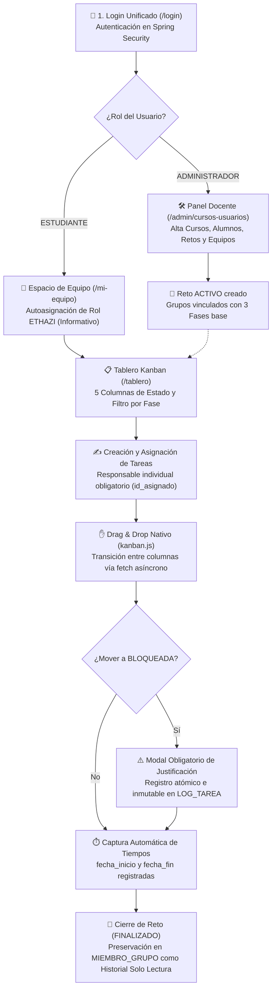
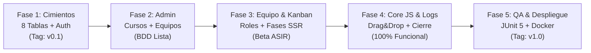

# 🗂️ Lauki — Mapeando el Caos


> **Centro Educativo:** Zabalburu Ikastetxea — 2º DAW (Desarrollo de Aplicaciones Web)  
> **Metodología Pedagógica:** Aprendizaje Colaborativo Basado en Retos (**ETHAZI**)  
> **Validación Interciclos:** CFGS ASIR (Administración de Sistemas Informáticos en Red)  
> **Estado del Software:** En Desarrollo Activo · Versión de Arquitectura V0.3 (8 tablas y ~44 archivos)

---

## 1. Encabezado y Descripción Corta

**Lauki** es una plataforma web ágil diseñada para la autoorganización de equipos de estudiantes en proyectos interdisciplinares bajo la metodología **ETHAZI**, facilitando la gestión visual de tareas en tableros Kanban, la imputación estricta de titularidad individual y la trazabilidad histórica inmutable de bloqueos e incidencias curso tras curso.

---

## 2. Demo y Elementos Visuales

### 🚀 Despliegue Local Rápido
Una vez arrancado el servicio mediante Docker Compose y Maven Wrapper, la aplicación está disponible de forma local en:
- **URL de Acceso:** [`http://localhost:8080`](http://localhost:8080)
- **Credenciales por Defecto (Admin precargado):** `admin@zabalburu.org` / `admin123`

```bash
# 1. Levantar contenedor de base de datos MySQL 8
docker compose up -d

# 2. Compilar y ejecutar la aplicación Spring Boot
./mvnw clean spring-boot:run
```

### 🔄 Flujo Operativo Principal de la Aplicación



### 📊 Representación Visual del Tablero Kanban

```text
┌──────────────────────────────────────────────────────────────────────────────────────────────────┐
│  TABLERO KANBAN — RETO 03: MAPEANDO EL CAOS                                                      │
│  Filtros: [Todas las Fases] [1. Análisis y Diseño] [2. Desarrollo] [3. Pruebas y Despliegue]     │
├──────────────┬──────────────┬──────────────┬──────────────────┬──────────────────────────────────┤
│  PENDIENTE   │ EN PROGRESO  │  BLOQUEADA   │  EN SUPERVISIÓN  │            COMPLETADA            │
├──────────────┼──────────────┼──────────────┼──────────────────┼──────────────────────────────────┤
│ [US-08]      │ [US-10]      │ [US-11] ⚠️   │ [US-07]          │ [US-01]                          │
│ Diseñar DTOs │ Drag & Drop  │ Error CORS   │ Validar Fases    │ Login & Security                 │
│ Fase: Desarr.│ Fase: Desarr.│ Motivo: ASIR │ Fase: Diseño     │ Fase: Diseño                     │
│ Resp: Mikel  │ Resp: Ander  │ Resp: Ane    │ Resp: Jon        │ Resp: Ander                      │
└──────────────┴──────────────┴──────────────┴──────────────────┴──────────────────────────────────┘
```

---

## 3. El Problema / Contexto

En el aprendizaje colaborativo basado en retos (**ETHAZI**), el alumnado trabaja en equipos autónomos donde surgen frecuentemente tres obstáculos críticos: la indefinición sobre quién es el titular individual de cada tarea, la falta de visibilidad en tiempo real sobre el avance global frente al cronograma y la incapacidad de anticipar y registrar formalmente los cuellos de botella técnicos.

**Lauki** resuelve esta problemática ofreciendo al profesorado una herramienta centralizada para gestionar el ciclo de vida académico de múltiples cursos lectivos, y proporcionando a los alumnos un tablero Kanban interactivo que bloquea transiciones no autorizadas, exige un responsable para cada tarea en progreso y documenta obligatoriamente el motivo de cada incidencia.

### 📚 Documentación Técnica Oficial (`documents/`)

Toda la especificación técnica de detalle está modularizada en el directorio [`documents/`](documents/), cumpliendo con los estándares de ingeniería de software:

```text
Recursos/
├── README.md                                   # Dashboard principal del proyecto
├── Roadmap_Proyecto_V0.3.md                    # Planificación en 5 fases y mapa de hitos
├── 03_Reto_DAW_2.pdf                           # Enunciado y rúbrica oficial ETHAZI
└── documents/
    ├── Modelo_de_Base_de_Datos.md              # [R4] Arquitectura relacional de 8 tablas y JPA
    ├── Especificacion_Casos_de_Uso.md          # [R1-R5] 8 Casos de Uso estructurados (IEEE 830)
    ├── Especificacion_Historias_de_Usuario.md  # [R1-R6] 13 Historias de Usuario con BDD
    └── Metodologia_Git_y_Commits_Semanticos.md # [R6] GitFlow Ligero, Conventional Commits y DoD
```

| Documento Técnico | Estándar / Metodología | Propósito y Contenido Principal | Enlace |
| :--- | :--- | :--- | :---: |
| **Modelo de Base de Datos** | Diagrama ER & JPA 6 | Arquitectura de **8 tablas** con claves primarias enteras (`Integer id`), diccionarios de tipos, constraints de unicidad y consultas derivadas Spring Data JPA. | 📄 **[Ver Documento](documents/Modelo_de_Base_de_Datos.md)** |
| **Especificación de Casos de Uso** | Estándar IEEE 830 | **8 Casos de Uso formales** (`CU-01` a `CU-08`) con actores, precondiciones, flujos principales y alternativos de error para login, administración y Kanban. | 📄 **[Ver Documento](documents/Especificacion_Casos_de_Uso.md)** |
| **Especificación de Historias de Usuario** | Agile Backlog + BDD | **13 Historias de Usuario** (`US-01` a `US-13`) con estimación, matriz de cobertura cruzada y criterios de aceptación en formato *Dado / Cuando / Entonces*. | 📄 **[Ver Documento](documents/Especificacion_Historias_de_Usuario.md)** |
| **Metodología Git y Commits Semánticos** | *GitFlow* + *Conventional Commits* | Estrategia de 3 niveles de ramas (`main`, `develop`, `feat/`), catálogo oficial de tipos/alcances, Definition of Done de PRs y chuleta de emergencia. | 📄 **[Ver Documento](documents/Metodologia_Git_y_Commits_Semanticos.md)** |

---

## 4. Funcionalidades Principales

1. **Tablero Kanban Interactivo con Drag & Drop Nativo:**  
   Organización visual en 5 columnas de estado (`PENDIENTE`, `EN_PROGRESO`, `BLOQUEADA`, `EN_SUPERVISION`, `COMPLETADA`) con filtrado por fase y transiciones fluidas en cliente gestionadas por JavaScript Vanilla (< 60 líneas).
2. **Titularidad Individual y Registro Transaccional de Bloqueos:**  
   Imposibilidad técnica de mover una tarea a curso sin asignarle un responsable individual (`id_asignado`), junto con la apertura obligatoria de un modal para registrar el motivo justificado en la tabla inmutable `LOG_TAREA` al moverla a `BLOQUEADA`.
3. **Gestión Académica Multi-Curso y Seguridad RBAC:**  
   Login unificado en `/login` con redirección por rol (`ADMINISTRADOR` o `ESTUDIANTE`), precarga automática del Administrador inicial vía `DataInitializer` y panel docente para crear cursos anuales, matricular usuarios, estructurar retos y conformar equipos.
4. **Fases Configurables y Dinámica ETHAZI:**  
   Generación automática de 3 fases predeterminadas por reto (*1. Análisis y Diseño*, *2. Desarrollo*, *3. Pruebas y Despliegue*) con capacidad de ordenación/creación personalizada, además de selector visual de rol colaborativo (*Gestor, Analista, Desarrollador, Colaborador*).
5. **Historial Inmutable de Proyectos Finalizados:**  
   Al concluir un reto académico, el equipo y su tablero quedan preservados para consulta histórica en modo solo lectura (`MIEMBRO_GRUPO` y `GRUPO.id_reto`), garantizando la consulta retrospectiva de evidencias curso tras curso.

---

## 5. Stack Tecnológico

| Capa / Dominio | Tecnología / Herramienta | Versión | Propósito Técnico en Lauki |
| :--- | :--- | :---: | :--- |
| **Backend** | **Java** | `21 LTS` | Uso intensivo de Java Records inmutables, Switch Expressions y Pattern Matching. |
| **Framework** | **Spring Boot** | `3.x` | Núcleo del servidor con Spring Web MVC (`spring-boot-starter-webmvc`). |
| **Seguridad** | **Spring Security** | `6.x` | Control de acceso basado en roles (RBAC), login único, hashing BCrypt y protección CSRF. |
| **Persistencia** | **Spring Data JPA / Hibernate** | `6.x` | Mapeo relacional de **8 entidades**, repositorios tipados con `Integer id` y sin claves compuestas. |
| **Base de Datos**| **MySQL** | `8.0` | Motor relacional ACID en contenedor Docker, juego de caracteres `utf8mb4` e integridad referencial. |
| **Validación** | **Jakarta Validation** | `Hibernate Val.` | Validación declarativa de modelos y DTOs (`@NotNull`, `@NotBlank`, `@Size`). |
| **Frontend SSR**| **Thymeleaf + Security Extras** | `Thymeleaf 3` | Renderizado del lado del servidor con protección y renderizado condicional de componentes. |
| **Diseño** | **Bootstrap** | `5.3` | Rejilla CSS responsiva, componentes visuales accesibles y modales interactivos. |
| **Interacción** | **JavaScript Vanilla** | `ES6+` | Drag & Drop nativo HTML5, peticiones asíncronas `fetch` (< 60 líneas) sin dependencias SPA pesadas. |
| **DevOps** | **Docker & Docker Compose** | `Compose v2` | Entorno contenerizado reproducible para entrega y validación técnica interciclos con ASIR. |
| **Testing** | **JUnit 5 + Mockito** | `Jupiter` | Pruebas unitarias y de integración sobre servicios y controladores (`@DataJpaTest`, `@WebMvcTest`). |
| **Construcción**| **Apache Maven** | `Wrapper 3.9+` | Empaquetado estandarizado y gestión del ciclo de vida del artefacto ejecutable JAR. |

---

## 6. Decisiones Técnicas

1. **Modelo Relacional Reducido a 8 Tablas con Claves Simples (`Integer id`):**  
   Se descartaron claves compuestas complejas (`@EmbeddableId`) y decoradores pesados de borrado lógico (`@SQLDelete`). Cada equipo (`GRUPO`) se vincula directamente al reto (`id_reto FK`), convirtiéndose en su propio tablero Kanban y garantizando que el historial se preserve en `MIEMBRO_GRUPO` sin requerir tablas redundantes.
2. **DTOs Inmutables con Java 21 Records y Factorías Estáticas:**  
   La comunicación entre controladores, servicios y vistas se realiza mediante `record` (`TareaDTO`, `LogTareaDTO`). Cada DTO incorpora un método estático de fábrica `.from(Entity)`, resolviendo dependencias de lectura y evitando desacoples y errores de mapeo en capas superiores.
3. **Erradicación de `LazyInitializationException` mediante `FetchType.EAGER` Selectivo:**  
   En las relaciones críticas de la entidad `Tarea` (`fase`, `asignado`), se emplea `FetchType.EAGER` junto con `CascadeType.ALL` en su colección de logs, garantizando que el serializador de Spring Boot y el renderizador de Thymeleaf tengan acceso inmediato a los datos sin recurrir al antipatrón `OpenSessionInView`.
4. **Arquitectura Híbrida Ligera (SSR Thymeleaf + Vanilla JS < 60 Líneas):**  
   En lugar de introducir sobrecarga con frameworks cliente SPA (React, Angular), se optó por un renderizado de servidor rápido y seguro, complementado con un script JavaScript ultraligero que aprovecha la API nativa HTML5 Drag & Drop y llamadas `fetch` asíncronas para actualizar estados en `/api/tareas/**`.
5. **Infraestructura Desacoplada y Parametrizada para Entrega ASIR:**  
   La base de datos MySQL 8 se ejecuta aislada en Docker con healthcheck de verificación de conectividad. Las propiedades en `application.properties` admiten variables de entorno (`SPRING_DATASOURCE_URL`, `DB_USERNAME`, `DB_PASSWORD`), permitiendo al ciclo de ASIR validar el despliegue sin alterar el código fuente.

---

## 7. Próximos Pasos / Roadmap

El desarrollo de Lauki se estructura en **5 Fases secuenciales** coordinadas con las ramas del repositorio. Para consultar el cronograma exhaustivo y la matriz de dependencias, visita [`Roadmap_Proyecto.md`](Roadmap_Proyecto.md).



### 📋 Mejoras Pendientes y Funcionalidades Futuras
- [ ] **Métricas de Rendimiento y Flujo:** Implementación de diagramas de flujo acumulado (*Cumulative Flow Diagram - CFD*) y gráficos de trabajo pendiente (*Burndown Chart*) por fase.
- [ ] **Notificaciones WebSockets en Tiempo Real:** Notificación visual inmediata a los miembros del equipo cuando una tarea es bloqueada o devuelta a supervisión.
- [ ] **Exportación Académica Docente:** Generación automatizada de informes en PDF/Excel con el historial completo de intervenciones y motivos de bloqueo para evaluación ETHAZI.
- [ ] **Integración con Repositorios Git:** Sincronización mediante Webhooks para asociar commits de GitHub o GitLab con el identificador de tarea correspondiente.

---

## 8. Autor y Contacto

Proyecto desarrollado por el equipo de desarrollo de **2º DAW** en **Zabalburu Ikastetxea** dentro del marco del Reto 03: *Mapeando el Caos*.

- **Institución:** [Zabalburu Ikastetxea](https://www.zabalburu.org/) — Bilbao, Bizkaia
- **Ciclo Formativo:** CFGS Desarrollo de Aplicaciones Web (DAW)
- **Repositorio Oficial:** [GitHub - Lauki / Mapeando el Caos](https://github.com/ander-zabalburu/Lauki)

---
*Lauki — Diseñado para transformar el caos de los retos colaborativos en avance ágil, medible y estructurado.*
