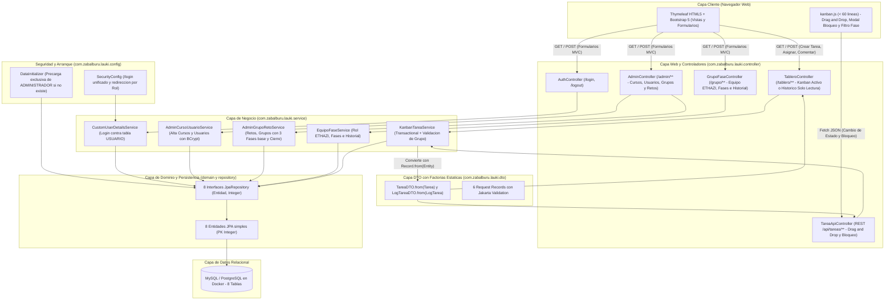
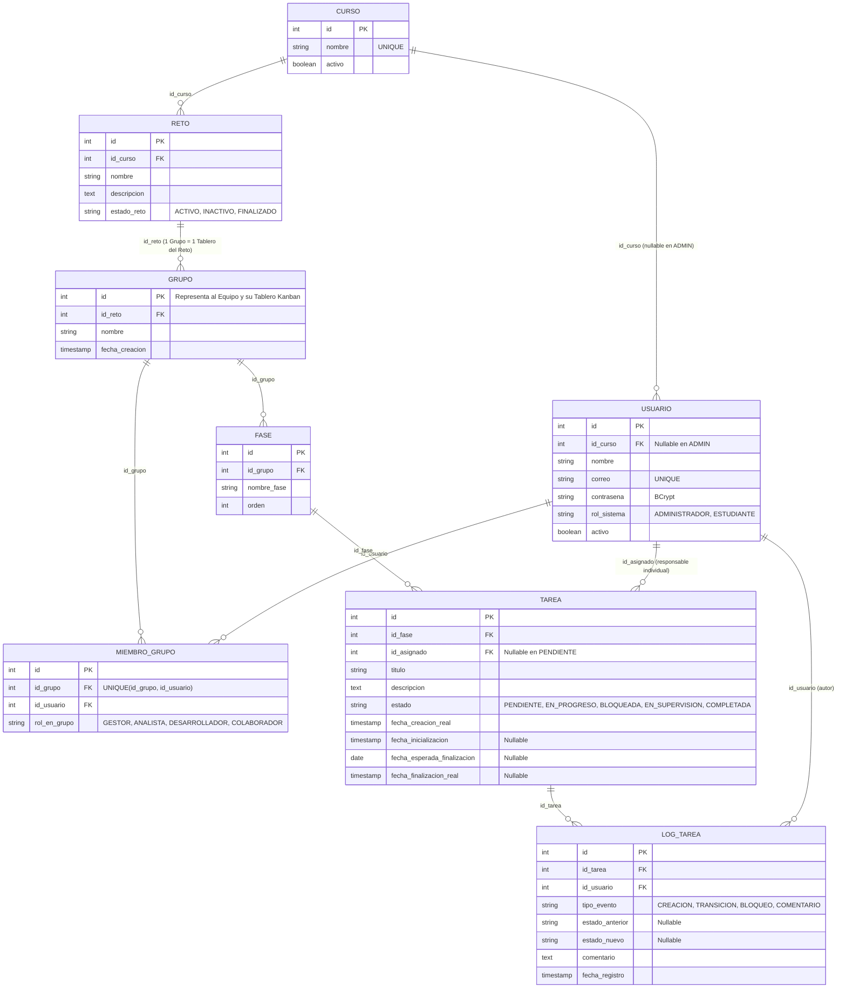
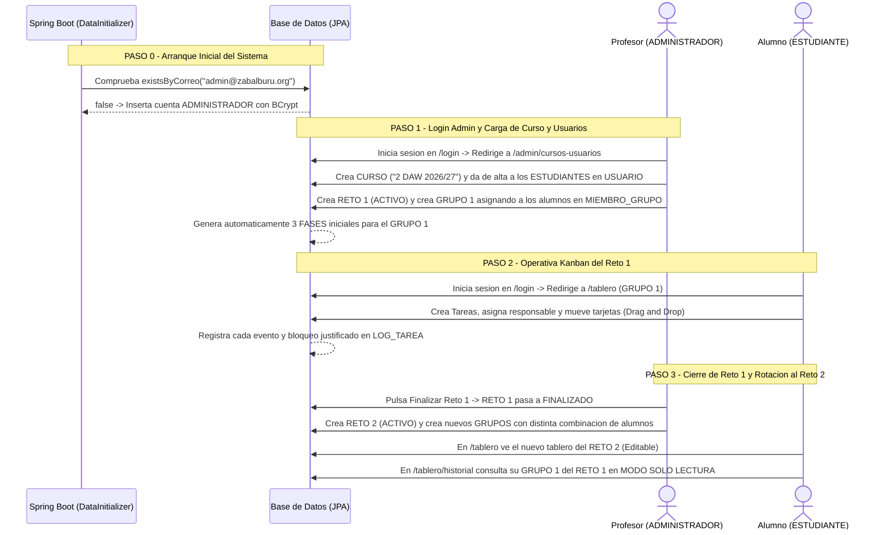

# 🏗️ Arquitectura de Software (Software Architecture) — Lauki

[⬅️ Volver al README principal](../README.md)

---

## 1. Diagrama de Arquitectura General (Frontend, Backend y Base de Datos)

**Lauki** implementa una arquitectura **Monolito Modular MVC** renderizada en servidor con **Spring Boot 3 y Thymeleaf**, complementada con un controlador REST interno (`TareaApiController`) para las operaciones interactivas Drag & Drop del tablero Kanban.



---

## 2. Diagrama Entidad-Relación (DER)

> 📄 Para consultar el diccionario completo de columnas, tipos SQL/JPA y la justificación de cada relación `1:N` y `N:M`, visita **[`Modelo_de_Base_de_Datos.md`](Modelo_de_Base_de_Datos.md)**.



---

## 3. Diagrama de Flujo del Usuario (User Flow)



---

## 4. Estructura de Paquetes y Componentes del Proyecto (`~44 Archivos`)

```text
lauki/
├── pom.xml
├── docker-compose.yml
└── src/main/
    ├── java/com/zabalburu/lauki/
    │   ├── LaukiApplication.java
    │   ├── config/
    │   │   ├── SecurityConfig.java              # Login único (/login), redirección por rol y CSRF ignorado en /api/**
    │   │   └── DataInitializer.java             # Precarga exclusiva de la cuenta ADMINISTRADOR inicial
    │   ├── domain/                              # 8 Entidades JPA con PK Integer + 5 Enums
    │   │   ├── Curso.java, Usuario.java, Reto.java, Grupo.java, MiembroGrupo.java, Fase.java, Tarea.java, LogTarea.java
    │   │   └── enums/ (RolSistema, RolEnGrupo, EstadoReto, EstadoTarea, TipoEventoLog)
    │   ├── dto/                                 # Records con factoría estática .from(Entity) y Jakarta Validation
    │   │   ├── TareaDTO.java, LogTareaDTO.java
    │   │   └── requests/ (CrearUsuarioRequest, CrearTareaRequest, CambiarEstadoTareaRequest, BloqueoTareaRequest, ComentarioRequest, AsignarRolRequest)
    │   ├── repository/                          # 8 Interfaces JpaRepository<Entidad, Integer>
    │   ├── service/                             # 5 Servicios de Negocio (@Transactional)
    │   │   ├── CustomUserDetailsService.java
    │   │   ├── AdminCursoUsuarioService.java
    │   │   ├── AdminGrupoRetoService.java
    │   │   ├── EquipoFaseService.java
    │   │   └── KanbanTareaService.java
    │   └── controller/                          # 4 Controladores MVC + 1 Controlador REST
    │       ├── AuthController.java, AdminController.java, GrupoFaseController.java, TableroController.java
    │       └── TareaApiController.java
    └── resources/
        ├── application.properties
        ├── static/ (css/custom.css, js/kanban.js)
        └── templates/ (fragments/, auth/login.html, admin/, estudiante/)
```
