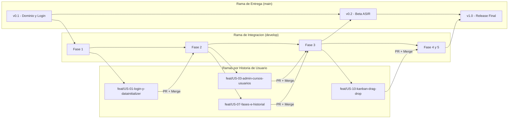

# 🌿 Guía de Contribución y Estilos Git (Contribution Guidelines / Git Workflow) — Lauki

[⬅️ Volver al README principal](../README.md) · [🗺️ Ir a Hoja de Ruta (Roadmap)](Roadmap.md)

---

## 1. Estrategia de Ramas (GitFlow Ligero)

El repositorio de **Lauki** se organiza en **3 niveles de ramas**:

1. **`main` (Producción / Entrega ASIR):** Contiene únicamente versiones estables listas para ejecutar con `docker compose up`. Solo recibe merges desde `develop`.
2. **`develop` (Integración Diaria):** Rama base donde confluye el trabajo de los 4 integrantes tras compilar y pasar `mvn test`.
3. **Ramas de Trabajo (`feat/...`, `fix/...`, `test/...`, `docs/...`, `chore/...`):** Creadas desde `develop` por cada Historia de Usuario (`US-01` a `US-13`) y fusionadas mediante Pull Request (PR).



---

## 2. Estándar de Commits Semánticos (Conventional Commits)

### 2.1. Formato Obligatorio
```text
<tipo>(<alcance>): <descripción breve en imperativo sin punto final> [US-XX]
```

### 2.2. Tipos (`<tipo>`) y Alcances (`<alcance>`)

| Tipo | Propósito | Alcances Oficiales de Lauki |
| :---: | :--- | :--- |
| **`feat`** | Nueva funcionalidad en backend, vista o JS | **`(domain)`**: Entidades JPA y Enums *(Integrante 1)* |
| **`fix`** | Corrección de bug o validación | **`(repo)`**: Interfaces `JpaRepository` *(Integrante 1)* |
| **`refactor`** | Mejora de código sin cambiar funcionalidad | **`(auth)`**: `SecurityConfig`, `DataInitializer`, Login *(Integrante 1)* |
| **`style`** | Ajustes visuales CSS / Bootstrap 5 | **`(admin)`**: Servicios, controlador y vistas Admin *(Integrante 2)* |
| **`test`** | Pruebas unitarias JUnit 5 y Mockito | **`(equipo)`**, **`(fases)`**, **`(historial)`** *(Integrante 3)* |
| **`docs`** | Documentación Markdown y diagramas | **`(kanban)`**: Servicio, controladores y `kanban.js` *(Integrante 4)* |
| **`chore`** | Configuración `pom.xml` y Docker | **`(dto)`**, **`(ui)`**, **`(docker)`** *(Todo el equipo)* |

### 2.3. Ejemplos de Buenos Commits en Lauki
- `feat(domain): crear las 8 entidades JPA con claves simples Integer [US-03]`
- `feat(auth): crear DataInitializer para precargar cuenta ADMINISTRADOR [US-01]`
- `feat(admin): generar 3 fases iniciales al crear un grupo de reto [US-04]`
- `feat(kanban): registrar motivo obligatorio en LOG_TAREA al bloquear [US-11]`
- `test(kanban): probar rechazo de salida de PENDIENTE sin responsable [US-10]`

---

## 3. Flujo Diario de Comandos Git

```bash
# 1. Situarse en develop actualizado al empezar la clase
git switch develop
git pull origin develop

# 2. Crear la rama de tu Historia de Usuario
git switch -c feat/US-10-kanban-drag-drop

# 3. Realizar commits semánticos atómicos
git add .
git commit -m "feat(kanban): implementar cambio de estado con captura de fechas [US-10]"

# 4. Comprobar tests, actualizar con develop y subir la rama
mvn clean test
git pull origin develop --rebase
git push -u origin feat/US-10-kanban-drag-drop
```
