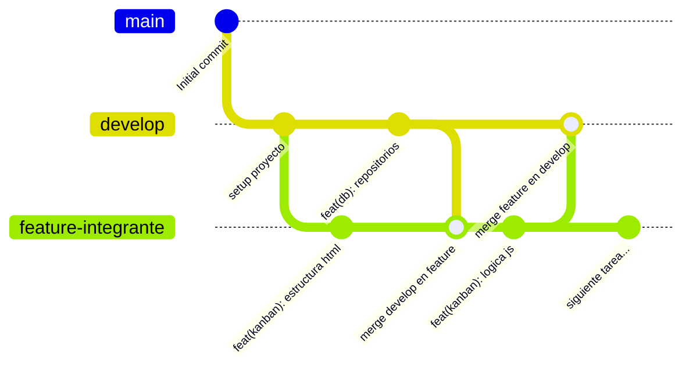

# 📘 Guía Paso a Paso: GitFlow por Consola, Ramas Persistentes y Commits Semánticos

Esta guía recoge el flujo de trabajo consensuado para el equipo de desarrollo de **Lauki**:
- **100% Terminal / Consola:** Sin intermediación de Pull Requests ni interfaces web.
- **Ramas fijas y persistentes por persona:** Cada integrante dispone de su rama de trabajo (ej. `feature-ander`, `feature-miren`), la cual **nunca se borra** tras integrarse en `develop`.
- **Trazabilidad estandarizada:** Historial uniforme con **Commits Semánticos**.

---

## 🌳 1. Mapa del Flujo de Integración Continua



- **`main`**: Rama entregable a producción / ASIR.
- **`develop`**: Rama común de integración.
- **`feature-integrante`**: Rama fija y personal de cada desarrollador (se mantiene activa a lo largo de todo el proyecto).

---

## 🚀 2. Flujo Paso a Paso 100% por Consola

### Paso 1: Acceso a tu rama de trabajo
```bash
# Si es la primera vez que creas tu rama personal:
git checkout develop
git pull origin develop
git checkout -b feature-integrante

# Para el día a día habitual (si ya existe en local):
git checkout feature-integrante
```

---

### Paso 2: Desarrollo diario y commits semánticos
Realiza cambios atómicos y añade tus modificaciones:

```bash
# 1. Comprobar ficheros tocados
git status

# 2. Añadir ficheros al área de preparación (stage)
git add ruta/al/fichero.java

# 3. Registrar el commit semántico
git commit -m "feat(tarea): validar campos obligatorios antes de persistir"
```

---

### Paso 3: Sincronizar tu rama con los últimos cambios de `develop`
> **⚠️ Paso Crítico:** Para evitar conflictos en la rama común, siempre trae primero lo que hayan subido tus compañeros a tu propia rama.

```bash
# 1. Actualiza tu develop local
git checkout develop
git pull origin develop

# 2. Vuelve a tu rama y fusiona develop en ella
git checkout feature-integrante
git merge develop
```

#### ¿Hay conflictos de merge?
Si Git muestra `CONFLICT (content)`:
1. Abre los ficheros marcados y acuerda con el compañero qué código prevalece.
2. Guarda los ficheros resueltos y márcalos:
   ```bash
   git add <ficheros_resueltos>
   git commit -m "chore(merge): resolver conflictos con develop"
   ```
*(Si necesitas abortar el intento de merge: `git merge --abort`)*.

---

### Paso 4: Subir tu rama a tu repositorio remoto
Asegura que tu rama personal esté respaldada en remoto:

```bash
# Primera subida:
git push -u origin feature-integrante

# Subidas posteriores:
git push
```

---

### Paso 5: Mergear tu rama en `develop` (Directo por Terminal)
Una vez tu rama funciona y compila en local con los cambios de `develop` ya absorbidos:

```bash
# 1. Sitúate en develop y confirma que esté al día
git checkout develop
git pull origin develop

# 2. Fusiona tu rama conservando el historial explícito (--no-ff)
git merge --no-ff feature-integrante

# 3. Sube la rama develop con tus cambios al servidor
git push origin develop
```

---

### Paso 6: Continuar trabajando en tu rama
> **📌 Regla del Equipo:** **NO** se borra la rama `feature-integrante`. Sigue viva para tus siguientes tareas.

```bash
# Vuelve a tu rama para comenzar la siguiente tarea
git checkout feature-integrante
```

---

## 🛠️ 3. Chuletario de Emergencias ("¿Qué hago si la he liado?")

| Situación / Error | Comando de rescate | Explicación |
| :--- | :--- | :--- |
| **Quiero cambiar a `develop` pero tengo cambios sin commitear** | `git stash`<br>`git checkout develop`<br>*(Al volver a tu rama)*: `git stash pop` | Guarda temporalmente tus cambios en un cajón seguro y luego los recupera sin perder nada. |
| **Me equivoqué en el mensaje del último commit (sin push)** | `git commit --amend -m "fix(auth): mensaje corregido"` | Sobrescribe el texto del último commit local. |
| **Olvidé incluir un fichero en el último commit (sin push)** | `git add fichero_olvidado`<br>`git commit --amend --no-edit` | Mete el fichero dentro del último commit sin pedir nuevo mensaje. |
| **Hice `git add .` por error y metí ficheros que no correspondían** | `git restore --staged <fichero>`<br>o todo: `git restore --staged .` | Desmarca los archivos de la zona de preparación sin alterar el contenido de tu disco. |
| **El merge con `develop` se complicó y quiero cancelarlo todo** | `git merge --abort` | Cancela la fusión y deja la rama exactamente como estaba antes de iniciar el merge. |
| **Hice commits directamente en `develop` en lugar de en mi rama** | `git branch feature-integrante`<br>`git reset --hard origin/develop` | Asigna los commits a tu rama y restablece `develop` al estado limpio remoto. |
| **Rompí código en local y quiero borrar todo lo no guardado** | `git restore .` | Descarta cualquier cambio local no commiteado. Acción irreversible. |
| **Ver el árbol completo de ramas y merges en terminal** | `git log --oneline --graph --all --decorate` | Visualizador gráfico de ramas y fusiones por consola. |

---

## 🏷️ 4. Guía de Commits Semánticos (Conventional Commits)

### Formato Obligatorio
```text
<tipo>(<alcance>): <descripción concisa en minúsculas y presente>
```

### Tipos Permitidos en Lauki

| Tipo | Propósito | Ejemplo |
| :---: | :--- | :--- |
| `feat` | Nueva funcionalidad en frontend, backend o base de datos | `feat(kanban): anadir arrastre de tarjetas entre columnas` |
| `fix` | Corrección de un fallo o error en el sistema | `fix(seguridad): corregir redireccion tras credenciales invalidas` |
| `docs` | Cambios exclusivos en documentación Markdown o diagramas | `docs(git): actualizar guia de integracion por consola` |
| `refactor` | Reestructuración de código sin alterar comportamiento | `refactor(entidad): simplificar metodos de sincronizacion de miembros` |
| `test` | Incorporación o ajuste de pruebas unitarias/integración | `test(servicio): validar transicion bloqueada sin justificacion` |
| `chore` | Configuración, Maven (`pom.xml`), Docker o `.gitignore` | `chore(docker): ajustar variables de entorno de base de datos` |
| `style` | Formato, espacios, punto y coma o limpieza de imports | `style(controlador): formatear clases segun estandar java` |

### Alcances Sugeridos
- `(auth)`: Login, filtros de Spring Security, permisos.
- `(kanban)`: Tablero, vistas, interacción visual y JavaScript.
- `(tarea)`: Modelo de tareas, transiciones, logs de bloqueo.
- `(db)`: Entidades JPA, repositorios, configuración de persistencia.
- `(dto)`: Records Java 21, mappers manuales.
- `(ui)`: Plantillas Thymeleaf, componentes Bootstrap.

### 🚫 Ejemplos a Recordar
- ❌ `git commit -m "subiendo cosas"`
- ❌ `git commit -m "feat: Login y arreglado el Dockerfile."`
- ✅ `git commit -m "feat(auth): implementar formulario de autenticacion"`
- ✅ `git commit -m "fix(db): desacoplar borrado de asignaciones en tareas"`
