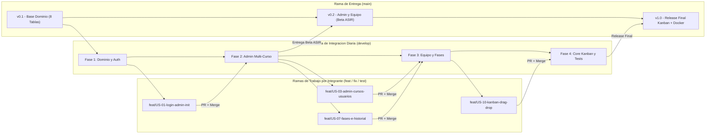
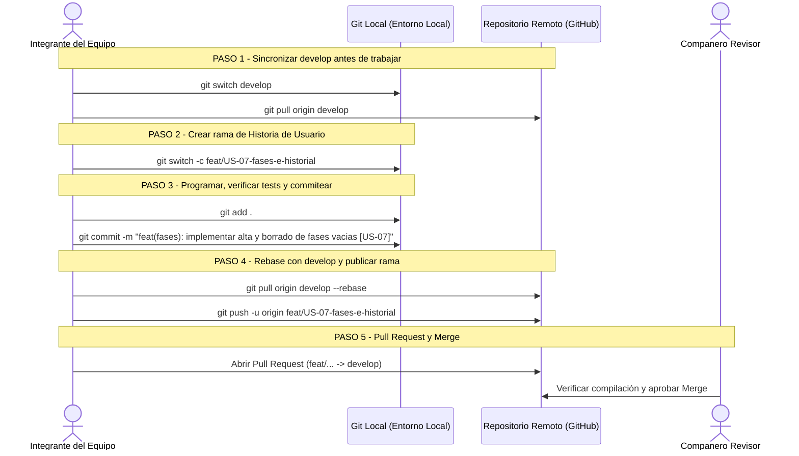

# 🐙 Metodología de Control de Versiones (Git), Commits Semánticos y Flujo de Trabajo (Lauki)

> **Proyecto:** Reto 03 — Mapeando el Caos (**Lauki**)  
> **Centro:** Zabalburu Ikastetxea — 2º DAW (Metodología ETHAZI)  
> **Versión de Referencia:** Arquitectura Simplificada y Multi-Curso (**8 Tablas y ~44 Archivos**)  
> **Requisito Cubierto:** **R6 — Calidad y Mantenibilidad** (Control de versiones colaborativo, trazabilidad por Historia de Usuario e integración continua hacia Docker/ASIR)  
> **Estándar Aplicado:** *GitFlow Ligero* + *Conventional Commits 1.0*  
> **Documentos Relacionados:** [Especificación Historias de Usuario](Especificacion_Historias_de_Usuario.md) · [Casos de Uso](Especificacion_Casos_de_Uso.md) · [Modelo de Base de Datos](Modelo_de_Base_de_Datos.md) · [Roadmap del Proyecto](../Roadmap_Proyecto_V0.3.md)

---

## 1. Estrategia de Ramas (GitFlow Ligero para 4 Integrantes)

Para optimizar el flujo de trabajo del equipo sin bloqueos ni conflictos complejos, el repositorio de **Lauki** emplea un modelo de **3 niveles de ramas**:

1. **`main` (Producción / Entrega ASIR):**
   - Contiene exclusivamente versiones 100% estables, probadas y preparadas para empaquetarse en Docker (`docker compose up`).
   - **Regla estricta:** No se realizan commits directos sobre `main`. Únicamente recibe fusiones (*Merge*) procedentes de `develop` al cerrar los hitos del Roadmap.
2. **`develop` (Integración Diaria del Equipo):**
   - Rama base donde confluye el trabajo de los 4 integrantes.
   - Todo código integrado en `develop` debe compilar (`mvn clean compile`) y superar las pruebas (`mvn test`).
3. **Ramas de Funcionalidad / Corrección (`feat/...`, `fix/...`, `test/...`, `docs/...`):**
   - Ramas de ciclo corto creadas desde `develop` para desarrollar una Historia de Usuario (`US-01` a `US-13`) o solucionar un defecto puntual.
   - Tras su revisión mediante Pull Request (PR), se integran en `develop` y se eliminan.



---

### 1.1. Nomenclatura Oficial de Ramas por Integrante

Cada rama debe nombrarse en minúsculas, separada por guiones y referenciando la Historia de Usuario (`US-XX`) asignada:

| Prefijo | Cuándo utilizarlo | Patrón | Ejemplos Reales en Lauki |
| :--- | :--- | :--- | :--- |
| **`feat/`** | Nueva funcionalidad o pantalla | `feat/US-XX-descripcion-corta` | `feat/US-01-login-y-datainitializer`<br/>`feat/US-03-admin-cursos-usuarios`<br/>`feat/US-04-grupos-con-fases-base`<br/>`feat/US-07-fases-e-historial`<br/>`feat/US-10-kanban-drag-drop` |
| **`fix/`** | Corrección de un fallo detectado | `fix/US-XX-error-corregido` | `fix/US-11-modal-bloqueo-vacio`<br/>`fix/US-10-recarga-al-fallar-fetch` |
| **`test/`** | Pruebas unitarias JUnit 5 (`R6`) | `test/CU-XX-nombre-servicio` | `test/CU-05-kanban-tarea-service`<br/>`test/CU-04-equipo-fase-service` |
| **`docs/`** | Documentación técnica o diagramas | `docs/tema-documentado` | `docs/modelo-datos-lauki`<br/>`docs/manual-despliegue-asir` |
| **`chore/`**| Configuración (`pom.xml`, Docker) | `chore/elemento-configurado` | `chore/docker-compose-mysql`<br/>`chore/variables-entorno-db` |

---

## 2. Estándar de Commits Semánticos (Conventional Commits 1.0)

Todos los mensajes de commit del proyecto deben seguir la especificación **Conventional Commits 1.0**, permitiendo identificar de un vistazo **qué se ha hecho**, **en qué capa del sistema** y **a qué requisito de negocio pertenece**.

### 2.1. Estructura del Mensaje de Commit

```text
<tipo>(<alcance>): <descripción breve en imperativo sin punto final> [US-XX]
```

* **Regla 1 (Imperativo presente):** Escribe *"añade"*, *"corrige"*, *"configura"*, *"valida"* (nunca en pasado ni gerundio).
* **Regla 2 (Concisión):** La primera línea no debe superar los **72 caracteres**.
* **Regla 3 (Trazabilidad obligatoria):** Si el commit implementa o corrige una Historia de Usuario, incluye al final `[US-XX]`.

---

### 2.2. Catálogo de Tipos (`<tipo>`) Permitidos

| Tipo | Significado Técnico | Ejemplo de Uso en Lauki |
| :---: | :--- | :--- |
| **`feat`** | Incorpora una nueva funcionalidad o vista de usuario. | `feat(kanban): implementar cambio de estado con captura de fechas [US-10]` |
| **`fix`** | Corrige un error de programación, validación o consulta JPA. | `fix(fases): impedir borrado de fase si contiene tareas [US-07]` |
| **`refactor`** | Reestructura código existente sin alterar su comportamiento funcional. | `refactor(dto): añadir factoria estatica TareaDTO.from con lista de logs [US-08]` |
| **`style`** | Ajustes visuales de interfaz (CSS, Bootstrap 5, layout) sin cambio lógico. | `style(ui): ajustar rejilla responsiva de las 5 columnas kanban [US-10]` |
| **`test`** | Incorpora o corrige pruebas unitarias con JUnit 5 y Mockito (`R6`). | `test(kanban): verificar rechazo al iniciar tarea sin responsable [US-10]` |
| **`docs`** | Documentación técnica en Markdown o diagramas Mermaid. | `docs(bdd): actualizar diccionario de las 8 tablas` |
| **`chore`** | Configuración de compilación (`pom.xml`, `.gitignore`, Docker). | `chore(docker): parametrizar SPRING_DATASOURCE_URL para entorno ASIR` |

---

### 2.3. Catálogo de Alcances (`<alcance>`) Oficiales de Lauki

El `<alcance>` indica el paquete o módulo de la aplicación afectado por el commit:

| Alcance | Paquete o Carpeta Afectada | Responsable Principal |
| :---: | :--- | :--- |
| **`(domain)`** | `com.zabalburu.lauki.domain` (8 Entidades JPA simples y 5 Enums) | Integrante 1 |
| **`(repo)`** | `com.zabalburu.lauki.repository` (8 Interfaces `JpaRepository<Entidad, Integer>`) | Integrante 1 |
| **`(auth)`** | `SecurityConfig`, `DataInitializer` (Admin), `CustomUserDetailsService`, `AuthController`, `login.html` | Integrante 1 |
| **`(admin)`** | `AdminCursoUsuarioService`, `AdminGrupoRetoService`, `AdminController`, `templates/admin/` | Integrante 2 |
| **`(equipo)`** | `EquipoFaseService` (rol ETHAZI), `GrupoFaseController`, `mi-equipo.html` | Integrante 3 |
| **`(fases)`** | `EquipoFaseService` (gestión de fases), `fases-reto.html` | Integrante 3 |
| **`(historial)`**| Consulta de retos `FINALIZADOS` en `MIEMBRO_GRUPO` y vista de solo lectura | Integrante 3 |
| **`(kanban)`** | `KanbanTareaService`, `TableroController`, `TareaApiController`, `kanban.js` | Integrante 4 |
| **`(dto)`** | `com.zabalburu.lauki.dto` (`TareaDTO.from`, `LogTareaDTO.from` y los records de petición) | Todos (según módulo) |
| **`(ui)`** | `templates/fragments/layout.html`, `modals-kanban.html`, `custom.css` | Todos |
| **`(docker)`** | `Dockerfile`, `docker-compose.yml`, configuración de red para ASIR | Todo el equipo (`R6`) |

---

### 2.4. Tabla Comparativa: Buenos vs. Malos Commits

| ❌ Mal Commit (Prohibido en el Reto) | ✅ Buen Commit Semántico en Lauki | Por qué es mejor |
| :--- | :--- | :--- |
| `git commit -m "subo mis cosas"` | `feat(domain): crear las 8 entidades JPA con claves simples Integer [US-03]` | Identifica los artefactos creados y vincula la historia de usuario. |
| `git commit -m "precarga admin"` | `feat(auth): crear DataInitializer para precargar cuenta ADMINISTRADOR [US-01]` | Registra la inicialización idempotente (`existsByCorreo`). |
| `git commit -m "arreglado error 403"` | `fix(auth): ignorar CSRF en rutas /api/** para permitir peticiones fetch [US-10]` | Refleja la configuración específica de seguridad en Spring Security. |
| `git commit -m "cambios en tareas"` | `feat(kanban): registrar motivo obligatorio en LOG_TAREA al bloquear [US-11]` | Documenta la regla de negocio y persistencia atómica. |
| `git commit -m "tests"` | `test(kanban): probar rechazo de salida de PENDIENTE sin responsable [US-10]` | Deja constancia del cumplimiento de criterios de calidad (`R6`). |

---

## 3. Flujo de Trabajo Diario Paso a Paso



---

## 4. Roadmap de Desarrollo e Integración Sincronizado con Git

El desarrollo del proyecto se divide en **5 Fases secuenciales** coordinadas con las ramas de Git para evitar bloqueos por dependencias entre integrantes:

| Fase | Nombre del Hito | Objetivo Principal y Entregable en `develop` / `main` | Ramas Principales que se Fusionan |
| :---: | :--- | :--- | :--- |
| **Fase 1** | **Cimientos, Dominio (8 Tablas) y Login** | Crear el proyecto base, las 8 entidades JPA, los 8 repositorios, `SecurityConfig`, `DataInitializer` (solo Admin) y `/login`. | `chore/estructura-inicial`<br/>`feat/US-01-login-y-datainitializer` |
| **Fase 2** | **Panel Admin Multi-Curso y Creación de Grupos** | Permitir que el Admin entre por `/login`, cree Cursos, cargue Estudiantes con BCrypt y cree Retos y Grupos (con sus 3 fases iniciales automáticas). | `feat/US-03-admin-cursos-usuarios`<br/>`feat/US-04-grupos-con-fases-base` |
| **Fase 3** | **Equipo ETHAZI, Fases y Vista Kanban SSR** | Selector de rol visual ETHAZI, gestión de fases del equipo, pintado de las 5 columnas del Kanban y formularios de creación/asignación de tareas (**1ª Entrega Beta a ASIR**). | `feat/US-06-mi-equipo-rol`<br/>`feat/US-07-gestion-fases`<br/>`feat/US-08-crear-asignar-tareas` |
| **Fase 4** | **Interactividad JS (Drag & Drop), Bloqueos e Historial** | Endpoints REST `/api/tareas/**`, `kanban.js` (< 60 líneas), bloqueo con motivo obligatorio en `LOG_TAREA`, cierre de reto (`FINALIZADO`) e Historial en solo lectura. | `feat/US-10-kanban-drag-drop`<br/>`feat/US-11-bloqueo-y-comentarios`<br/>`feat/US-12-cierre-reto`<br/>`feat/US-13-historial-solo-lectura` |
| **Fase 5** | **Testing JUnit 5, Dockerización Final y Defensa** | Suite de pruebas unitarias (`KanbanTareaServiceTest`, `EquipoFaseServiceTest`), validación cruzada con ASIR en Docker y preparación de la defensa (`Release v1.0` en `main`). | `test/CU-05-kanban-service`<br/>`test/CU-04-fases-service`<br/>`chore/docker-compose-release` |

---

## 5. Checklist de Pull Request (Definition of Done)

Antes de pulsar **"Merge pull request"** hacia `develop`, el autor y el compañero revisor deben verificar estos 4 puntos indispensables:

- [ ] **Compilación y Pruebas:** `mvn clean test` termina en `BUILD SUCCESS` en local.
- [ ] **Persistencia Robusta:** La entidad `Tarea` conserva `FetchType.EAGER` en `fase`/`asignado` y `CascadeType.ALL` en `logs` para prevenir `LazyInitializationException`.
- [ ] **Secretos y Entorno:** No se han subido carpetas generadas (`target/`, `.idea/`, `.vscode/` en `.gitignore`) y `application.properties` utiliza variables de entorno con fallback para Docker.
- [ ] **Commits Semánticos:** Todos los commits de la rama respetan la convención `<tipo>(<alcance>): <descripción> [US-XX]`.

---

## 6. Chuleta de Emergencia Git (Soluciones Rápidas en el Aula)

| Situación de Emergencia | Comando de Solución Rápida |
| :--- | :--- |
| **"Me he equivocado al escribir el mensaje del último commit (aún no hice push)"** | `git commit --amend -m "feat(kanban): mensaje corregido [US-10]"` |
| **"Empecé a programar directamente en `develop` y olvidé crear mi rama `feat/...`"** | `git switch -c feat/US-XX-mi-rama`<br/>*(Mueve automáticamente tus cambios sin commitear a la nueva rama).* |
| **"Hice un commit en local pero me faltó incluir un archivo olvidado"** | `git add archivo_olvidado.java`<br/>`git commit --amend --no-edit` |
| **"Quiero deshacer el último commit pero SIN perder el código que he escrito"** | `git reset --soft HEAD~1` |
| **"He roto un archivo probando cosas y quiero dejarlo como estaba en el último commit"** | `git restore ruta/al/Archivo.java` |
| **"Tengo cambios a medias que aún no compilan y necesito cambiar de rama un momento"** | `git stash` *(guarda en cajón temporal)*<br/>`git stash pop` *(los recupera después)* |
