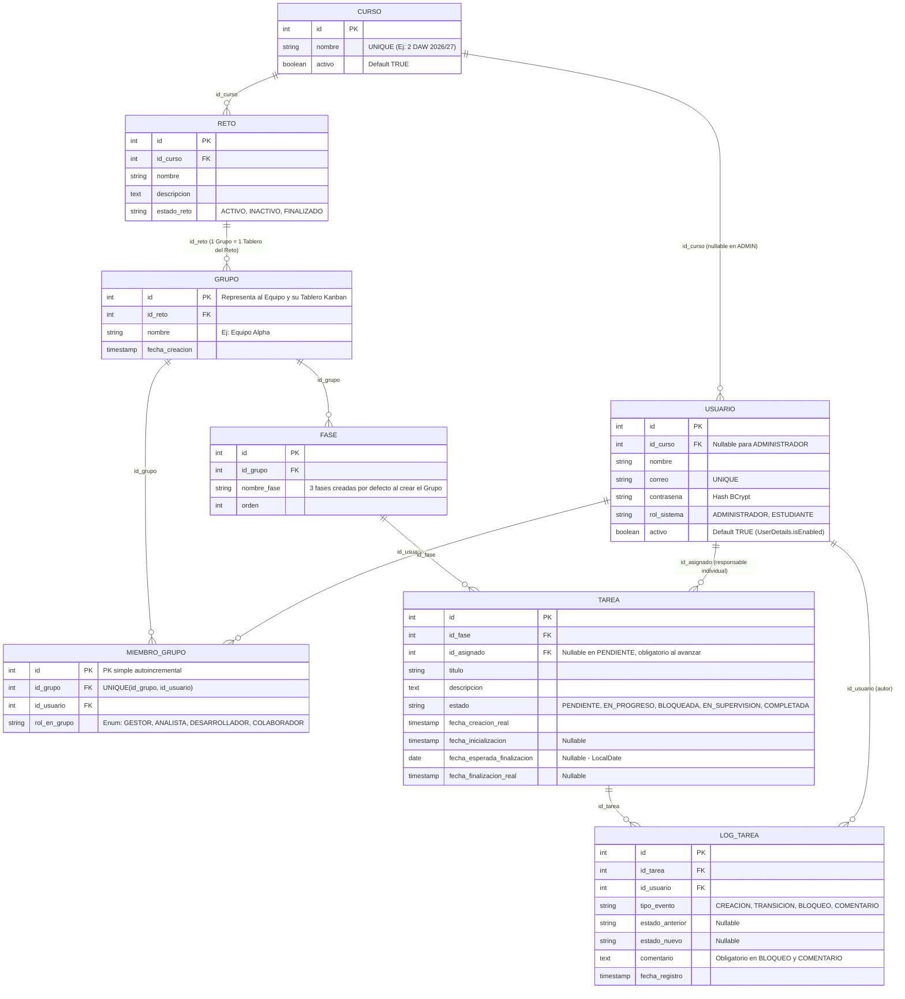

# 🗄️ Modelo de Base de Datos Relacional: "Mapeando el Caos" (Lauki)

> **Proyecto:** Reto 03 — Mapeando el Caos (**Lauki**)  
> **Centro:** Zabalburu Ikastetxea — 2º DAW (Metodología ETHAZI)  
> **Arquitectura de Persistencia:** **8 Tablas Relacionales** con Claves Simples (`Integer id`) y Soporte Multi-Curso  
> **Tecnologías:** Spring Boot 3 + Spring Data JPA (Hibernate 6) + Base de Datos Relacional (MySQL / MariaDB / PostgreSQL)  
> **Documentos Relacionados:** [Explicación de Relaciones](Explicacion_Relaciones_Base_de_Datos.md) · [Persistencia Histórica y Ciclo de Cursos](Persistencia_Historica_y_Ciclo_de_Cursos.md) · [Esquema DSL Eraser.io](Esquema_Entidad_Relacion_Eraser.md)

---

## 1. Diagrama Entidad-Relación (ER) Simplificado (8 Tablas)

El modelo relacional de **Lauki** está estructurado en **8 tablas exactas**, todas con clave primaria simple de 32 bits (`INT AUTO_INCREMENT` / `Integer id` en Java):

1. **Soporte completo para futuros cursos escolares (`CURSO` y `USUARIO`):** `DataInitializer.java` precarga únicamente la cuenta `ADMINISTRADOR` del profesorado. Desde el panel web, el profesor crea los cursos de cada año y carga a los estudiantes en la base de datos.
2. **Unificación de Equipo, Tablero e Historial (`GRUPO.id_reto`):** En ETHAZI los grupos se conforman para cada reto. Al apuntar `GRUPO` directamente a `RETO` (`id_reto FK`), cada `GRUPO` es el propio Tablero Kanban del equipo en ese reto y sus filas en `MIEMBRO_GRUPO` quedan conservadas para siempre como historial cuando el reto pasa a `FINALIZADO`.
3. **Cero Claves Compuestas (`@Embeddable`) y Cero `@SQLDelete`:** `MIEMBRO_GRUPO` usa una PK simple `id` con restricción `UNIQUE(id_grupo, id_usuario)`, y la desactivación de cursos o usuarios antiguos se resuelve con un campo estándar `activo BOOLEAN DEFAULT TRUE`.

---

## 2. Diccionario de las 8 Tablas y Mapeo JPA

> [!TIP]
> **Compatibilidad Linux / Docker (ASIR):** En todas las anotaciones `@Table(name = "...")` se deben usar nombres en minúsculas (`curso`, `usuario`, `reto`, `grupo`, `miembro_grupo`, `fase`, `tarea`, `log_tarea`) para evitar errores de distinción de mayúsculas/minúsculas de MySQL sobre contenedores Linux.

### 2.1. `CURSO` (`@Table(name = "curso")`)
| Columna | Tipo SQL | Tipo Java (JPA) | Restricciones | Propósito |
| :--- | :--- | :--- | :--- | :--- |
| `id` | `INT AUTO_INCREMENT` | `Integer` | `PRIMARY KEY` | Identificador único del curso académico. |
| `nombre` | `VARCHAR(100)` | `String` | `UNIQUE NOT NULL` | Nombre de la promoción (ej. *"2º DAW 2026/27"*, *"2º DAW 2027/28"*). |
| `activo` | `BOOLEAN` | `Boolean` | `NOT NULL DEFAULT TRUE` | Permite ocultar promociones de años pasados en los desplegables de alta sin perder su historial. |

### 2.2. `USUARIO` (`@Table(name = "usuario")`)
| Columna | Tipo SQL | Tipo Java (JPA) | Restricciones | Propósito |
| :--- | :--- | :--- | :--- | :--- |
| `id` | `INT AUTO_INCREMENT` | `Integer` | `PRIMARY KEY` | Identificador único del usuario. |
| `id_curso` | `INT` | `Curso` (`@ManyToOne`) | `NULL, FOREIGN KEY (curso.id)` | Nulo para `ADMINISTRADOR`; obligatorio para `ESTUDIANTE`. |
| `nombre` | `VARCHAR(100)` | `String` | `NOT NULL` | Nombre y apellidos del profesor o estudiante. |
| `correo` | `VARCHAR(150)` | `String` | `UNIQUE NOT NULL` | Correo institucional usado como username en `/login`. |
| `contrasena` | `VARCHAR(255)` | `String` | `NOT NULL` | Hash cifrado con `BCryptPasswordEncoder`. |
| `rol_sistema` | `VARCHAR(20)` | `RolSistema` (Enum) | `NOT NULL` | `ADMINISTRADOR` o `ESTUDIANTE`. |
| `activo` | `BOOLEAN` | `Boolean` | `NOT NULL DEFAULT TRUE` | Si es `false`, Spring Security impide su login (`isEnabled()`), pero su nombre sigue visible en tareas y logs antiguos. |

### 2.3. `RETO` (`@Table(name = "reto")`)
| Columna | Tipo SQL | Tipo Java (JPA) | Restricciones | Propósito |
| :--- | :--- | :--- | :--- | :--- |
| `id` | `INT AUTO_INCREMENT` | `Integer` | `PRIMARY KEY` | Identificador único del reto. |
| `id_curso` | `INT` | `Curso` (`@ManyToOne`) | `NOT NULL, FOREIGN KEY (curso.id)` | Curso académico en el que se imparte el reto. |
| `nombre` | `VARCHAR(150)` | `String` | `NOT NULL` | Título del reto (ej. *"Reto 03 — Mapeando el Caos"*). |
| `descripcion` | `TEXT` | `String` | `NOT NULL` | Enunciado y objetivos del reto. |
| `estado_reto` | `VARCHAR(20)` | `EstadoReto` (Enum) | `NOT NULL` | `ACTIVO` (editable), `INACTIVO` (en preparación), `FINALIZADO` (histórico en solo lectura). |

### 2.4. `GRUPO` (`@Table(name = "grupo")`) — *Actúa como Equipo y Tablero Kanban*
| Columna | Tipo SQL | Tipo Java (JPA) | Restricciones | Propósito |
| :--- | :--- | :--- | :--- | :--- |
| `id` | `INT AUTO_INCREMENT` | `Integer` | `PRIMARY KEY` | Identificador único del grupo/tablero. |
| `id_reto` | `INT` | `Reto` (`@ManyToOne`) | `NOT NULL, FOREIGN KEY (reto.id)` | Reto al que pertenece este equipo y su tablero Kanban. |
| `nombre` | `VARCHAR(100)` | `String` | `NOT NULL` | Nombre del equipo (ej. *"Equipo Alpha"*). |
| `fecha_creacion` | `TIMESTAMP` | `LocalDateTime` | `NOT NULL DEFAULT CURRENT_TIMESTAMP` | Fecha de creación del equipo/tablero. |

### 2.5. `MIEMBRO_GRUPO` (`@Table(name = "miembro_grupo")`) — *Miembros actuales e Historial*
| Columna | Tipo SQL | Tipo Java (JPA) | Restricciones | Propósito |
| :--- | :--- | :--- | :--- | :--- |
| `id` | `INT AUTO_INCREMENT` | `Integer` | `PRIMARY KEY` | Clave primaria simple (sin `@EmbeddedId`). |
| `id_grupo` | `INT` | `Grupo` (`@ManyToOne`) | `NOT NULL, FOREIGN KEY (grupo.id)` | Grupo/tablero al que pertenece el alumno en ese reto. |
| `id_usuario` | `INT` | `Usuario` (`@ManyToOne`) | `NOT NULL, FOREIGN KEY (usuario.id)` | Estudiante integrante del equipo. |
| `rol_en_grupo` | `VARCHAR(20)` | `RolEnGrupo` (Enum) | `NOT NULL` | Etiqueta visual ETHAZI: `GESTOR`, `ANALISTA`, `DESARROLLADOR`, `COLABORADOR`. |

> [!NOTE]
> Restricción de unicidad en la entidad JPA: `@UniqueConstraint(columnNames = {"id_grupo", "id_usuario"})`.

### 2.6. `FASE` (`@Table(name = "fase")`)
| Columna | Tipo SQL | Tipo Java (JPA) | Restricciones | Propósito |
| :--- | :--- | :--- | :--- | :--- |
| `id` | `INT AUTO_INCREMENT` | `Integer` | `PRIMARY KEY` | Identificador único de la fase. |
| `id_grupo` | `INT` | `Grupo` (`@ManyToOne`) | `NOT NULL, FOREIGN KEY (grupo.id)` | Grupo/tablero propietario de la fase. |
| `nombre_fase` | `VARCHAR(100)` | `String` | `NOT NULL` | Nombre de la etapa (ej. *"1. Análisis"*, *"2. Desarrollo"*, *"3. Pruebas"*). |
| `orden` | `INT` | `Integer` | `NOT NULL` | Orden numérico de visualización (1, 2, 3...). |

### 2.7. `TAREA` (`@Table(name = "tarea")`)
| Columna | Tipo SQL | Tipo Java (JPA) | Restricciones | Propósito |
| :--- | :--- | :--- | :--- | :--- |
| `id` | `INT AUTO_INCREMENT` | `Integer` | `PRIMARY KEY` | Identificador único de la tarea. |
| `id_fase` | `INT` | `Fase` (`@ManyToOne EAGER`) | `NOT NULL, FOREIGN KEY (fase.id)` | Fase a la que pertenece la tarea. |
| `id_asignado` | `INT` | `Usuario` (`@ManyToOne EAGER`)| `NULL, FOREIGN KEY (usuario.id)` | Responsable individual (obligatorio para salir de `PENDIENTE`). |
| `titulo` | `VARCHAR(200)` | `String` | `NOT NULL` | Título descriptivo de la tarea. |
| `descripcion` | `TEXT` | `String` | `NULL` | Detalle técnico del entregable. |
| `estado` | `VARCHAR(25)` | `EstadoTarea` (Enum) | `NOT NULL` | `PENDIENTE`, `EN_PROGRESO`, `BLOQUEADA`, `EN_SUPERVISION`, `COMPLETADA`. |
| `fecha_creacion_real` | `TIMESTAMP` | `LocalDateTime` | `NOT NULL` | Momento exacto de creación. |
| `fecha_inicializacion` | `TIMESTAMP` | `LocalDateTime` | `NULL` | Timestamp al salir de `PENDIENTE` por primera vez. |
| `fecha_esperada_finalizacion`| `DATE` | `LocalDate` | `NULL` | Fecha límite estimada (`<input type="date">`). |
| `fecha_finalizacion_real` | `TIMESTAMP` | `LocalDateTime` | `NULL` | Timestamp al llegar a `COMPLETADA` (`null` si se reabre). |

### 2.8. `LOG_TAREA` (`@Table(name = "log_tarea")`) — *Auditoría Inmutable*
| Columna | Tipo SQL | Tipo Java (JPA) | Restricciones | Propósito |
| :--- | :--- | :--- | :--- | :--- |
| `id` | `INT AUTO_INCREMENT` | `Integer` | `PRIMARY KEY` | Identificador secuencial del evento. |
| `id_tarea` | `INT` | `Tarea` (`@ManyToOne`) | `NOT NULL, FOREIGN KEY (tarea.id)` | Tarea auditada (con borrado en cascada si se elimina una tarea errónea). |
| `id_usuario` | `INT` | `Usuario` (`@ManyToOne EAGER`)| `NOT NULL, FOREIGN KEY (usuario.id)` | Autor del movimiento, bloqueo o comentario. |
| `tipo_evento` | `VARCHAR(20)` | `TipoEventoLog` (Enum) | `NOT NULL` | `CREACION`, `TRANSICION`, `BLOQUEO`, `COMENTARIO`. |
| `estado_anterior` | `VARCHAR(25)` | `EstadoTarea` (Enum) | `NULL` | Columna previa en cambios de estado. |
| `estado_nuevo` | `VARCHAR(25)` | `EstadoTarea` (Enum) | `NULL` | Nueva columna alcanzada. |
| `comentario` | `TEXT` | `String` | `NULL` | Texto obligatorio en `BLOQUEO` (motivo) y en `COMENTARIO`. |
| `fecha_registro` | `TIMESTAMP` | `LocalDateTime` | `NOT NULL` | Momento exacto del registro. |

---

## 3. Consultas Clave en Spring Data JPA

Al eliminar las tablas intermedias y los filtros `@SQLRestriction`, todas las consultas de los repositorios son métodos derivados directos de 1 línea:

| Necesidad de Negocio | Repositorio | Método Derivado en Spring Data JPA |
| :--- | :--- | :--- |
| **Validar login o evitar duplicar Admin** | `UsuarioRepository` | `Optional<Usuario> findByCorreo(String correo);` `boolean existsByCorreo(String correo);` |
| **Listar alumnos activos de un curso** | `UsuarioRepository` | `List<Usuario> findByCursoIdAndActivoTrue(Integer idCurso);` |
| **Obtener el Grupo/Tablero activo del alumno** | `MiembroGrupoRepository` | `Optional<MiembroGrupo> findFirstByUsuarioIdAndGrupoRetoEstadoReto(Integer idUsuario, EstadoReto estado);` |
| **Obtener el Historial de retos finalizados del alumno** | `MiembroGrupoRepository` | `List<MiembroGrupo> findByUsuarioIdAndGrupoRetoEstadoRetoOrderByGrupoIdDesc(Integer idUsuario, EstadoReto estado);` |
| **Validar pertenencia al grupo o al reto** | `MiembroGrupoRepository` | `List<MiembroGrupo> findByGrupoId(Integer idGrupo);` `boolean existsByGrupoIdAndUsuarioId(Integer idGrupo, Integer idUsuario);` `boolean existsByUsuarioIdAndGrupoRetoId(Integer idUsuario, Integer idReto);` |
| **Listar fases ordenadas del tablero** | `FaseRepository` | `List<Fase> findByGrupoIdOrderByOrdenAsc(Integer idGrupo);` |
| **Listar tareas del tablero y comprobar fase vacía** | `TareaRepository` | `List<Tarea> findByFaseGrupoId(Integer idGrupo);` `boolean existsByFaseId(Integer idFase);` |
| **Listar logs/comentarios de una tarea** | `LogTareaRepository` | `List<LogTarea> findByTareaIdOrderByFechaRegistroDesc(Integer idTarea);` |
