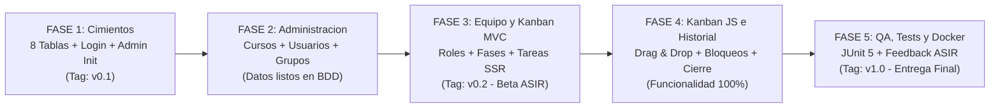

# 🗺️ Hoja de Ruta (Roadmap) — Lauki

[⬅️ Volver al README principal](../README.md) · [🌿 Ir a Guía de Contribución y Git](Guia_Contribucion_y_Git.md)

---

## 1. Cronograma General en 5 Fases

---

## 2. Desglose de Trabajo por Fase e Integrante (25% Equilibrado)

### 🚀 Fase 1: Cimientos, Dominio (8 Tablas) y Login (`v0.1`)
| Integrante | Tareas Asignadas | Rama Git | Entregable |
| :--- | :--- | :--- | :--- |
| **Integrante 1** | Proyecto base, 8 Entidades JPA, 5 Enums, 8 Repositorios, `SecurityConfig`, `CustomUserDetailsService`, `DataInitializer` (Admin) y `login.html`. | `feat/US-01-login-y-datainitializer` | Tablas creadas y login de Administrador operativo. |
| **Integrante 2** | Record `CrearUsuarioRequest` y maquetación Bootstrap 5 de `admin/cursos-usuarios.html` y `admin/grupos-retos.html`. | `feat/US-03-maqueta-admin` | Vistas de administración maquetadas. |
| **Integrante 3** | Record `AsignarRolRequest`, fragmento común `layout.html` (Navbar + Logout), `mi-equipo.html` y `fases-reto.html`. | `feat/US-06-layout-y-equipo-ui` | Layout de navegación común para el equipo. |
| **Integrante 4** | Records `TareaDTO` y `LogTareaDTO` (con `.from(Entity)`), `CrearTareaRequest`, `CambiarEstadoTareaRequest`, `BloqueoTareaRequest` y `ComentarioRequest`. | `feat/US-08-dtos-kanban` | Capa `dto/` completa en `develop`. |

---

### 🏗️ Fase 2: Administración Multi-Curso y Creación de Grupos
| Integrante | Tareas Asignadas | Rama Git | Entregable |
| :--- | :--- | :--- | :--- |
| **Integrante 1** | Redirección automática post-login según rol (`ADMINISTRADOR` vs `ESTUDIANTE`) y cierre de sesión (`US-02`). | `feat/US-02-redireccion-y-logout` | Rutas protegidas por rol (`R5`). |
| **Integrante 2** | `AdminCursoUsuarioService` (alta de cursos y alumnos con BCrypt), `AdminGrupoRetoService` (retos y grupos con 3 fases iniciales) y `AdminController`. | `feat/US-03-admin-cursos-usuarios` `feat/US-04-grupos-con-fases-base` | Alta web de cursos, alumnos, retos y grupos. |
| **Integrante 3** | `EquipoFaseService` y `GrupoFaseController` para la vista de **Mi Equipo** y cambio del rol visual ETHAZI (`US-06`). | `feat/US-06-selector-rol-ethazi` | Selector de rol ETHAZI operativo. |
| **Integrante 4** | Maquetación de las 5 columnas en `estudiante/tablero-kanban.html` y modales en `fragments/modals-kanban.html`. | `feat/US-08-vista-tablero-ssr` | Tablero Kanban y modales maquetados. |

---

### 📋 Fase 3: Gestión de Fases, Kanban MVC y 1ª Entrega Beta a ASIR (`v0.2`)
| Integrante | Tareas Asignadas | Rama Git | Entregable |
| :--- | :--- | :--- | :--- |
| **Integrante 1** | `Dockerfile` y `docker-compose.yml` con variables de entorno (`SPRING_DATASOURCE_URL`) para entrega a **ASIR**. | `chore/docker-entrega-asir` | Despliegue con `docker compose up --build`. |
| **Integrante 2** | Desactivación (`activo = false`) de cursos/usuarios (`US-05`) y botón **"Finalizar Reto"** (`estado_reto = FINALIZADO`, `US-12`). | `feat/US-05-desactivar-catalogo` `feat/US-12-finalizar-reto` | Panel de Administración 100% completado. |
| **Integrante 3** | Alta de nuevas fases ordenadas y bloqueo de borrado si la fase contiene tareas (`existsByFaseId`, `US-07`). | `feat/US-07-gestion-fases` | Gestión de fases del tablero terminada. |
| **Integrante 4** | `KanbanTareaService` y `TableroController`: crear tarea, asignar responsable individual, comentar y eliminar tarea errónea. | `feat/US-08-crud-tareas-mvc` | Operativa Kanban por formularios MVC lista. |

---

### ⚡ Fase 4: Interactividad JS (Drag & Drop), Bloqueos e Historial en Solo Lectura
| Integrante | Tareas Asignadas | Rama Git | Entregable |
| :--- | :--- | :--- | :--- |
| **Integrante 1** | Verificación de permisos y exención CSRF en `/api/tareas/**` junto con pruebas de sesión. | `fix/US-10-ajustes-security-api` | Endpoints REST protegidos y accesibles por `fetch`. |
| **Integrante 2** | Pruebas de cierre de Reto 1 y creación de nuevos grupos en Reto 2 verificando la rotación de equipos. | `fix/US-12-validacion-rotacion` | Rotación de grupos entre retos validada. |
| **Integrante 3** | Consulta de **Historial de Retos Finalizados** (`US-13`) cargando `/tablero/historial/{idGrupo}` con `soloLectura = true`. | `feat/US-13-historial-solo-lectura` | Historial de retos pasados en solo lectura. |
| **Integrante 4** | `TareaApiController` (`PATCH estado` y `POST bloquear`), captura de tiempos y `kanban.js` (< 60 líneas: Drag & Drop, modal de bloqueo y filtro por fase). | `feat/US-10-kanban-drag-drop` `feat/US-11-modal-bloqueo-api` | Kanban interactivo completo (`R2`, `R3`). |

---

### 🧪 Fase 5: Pruebas Automatizadas (JUnit 5), Feedback ASIR y Release Final (`v1.0`)
| Integrante | Tareas Asignadas | Rama Git | Entregable |
| :--- | :--- | :--- | :--- |
| **Integrante 1** | Manual de despliegue local/Docker y verificación del arranque limpio para evaluación (`R6`). | `docs/manual-ejecucion-docker` | Entorno Docker final verificado con ASIR. |
| **Integrante 2** | Tests unitarios JUnit 5 en `AdminGrupoRetoServiceTest` (creación de 3 fases iniciales y cierre de reto). | `test/CU-02-admin-grupo-reto-service` | Tests de Administración en verde. |
| **Integrante 3** | Tests unitarios JUnit 5 en `EquipoFaseServiceTest` (impedir borrar fase con tareas). | `test/CU-04-equipo-fase-service` | Tests de Fases e Historial en verde. |
| **Integrante 4** | Tests unitarios JUnit 5 en `KanbanTareaServiceTest` (responsable obligatorio, fechas y bloqueo con motivo). | `test/CU-05-kanban-tarea-service` | Tests de Kanban en verde (`mvn test`). |
