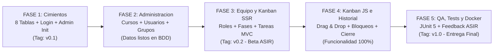
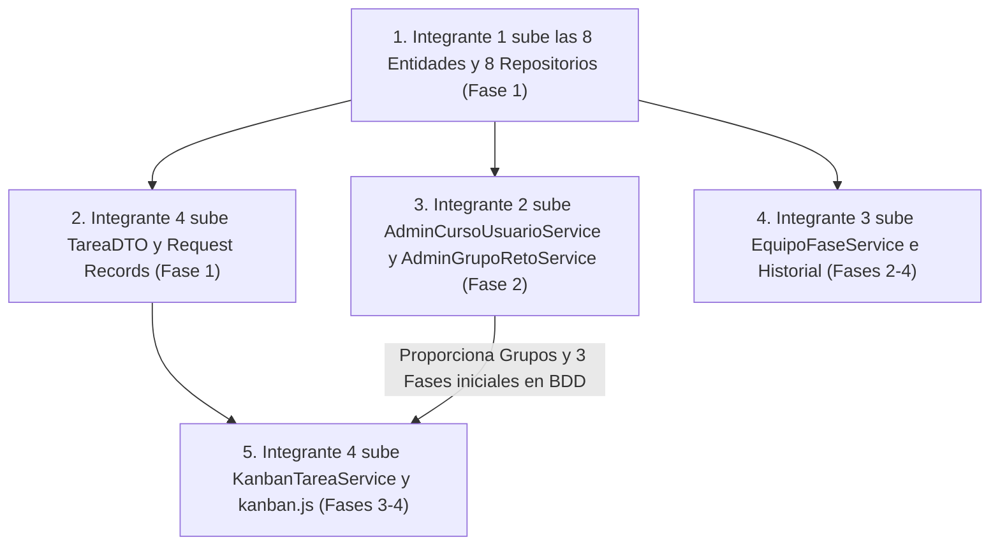

# Roadmap de Desarrollo del Proyecto (V0.3): "Mapeando el Caos" (LAUKI)

**Proyecto:** Reto 03 — Mapeando el Caos (**LAUKI**)  
**Centro:** Zabalburu Ikastetxea — 2º DAW (Metodología ETHAZI)  
**Versión de Referencia:** **[`Prototipo V0.3`](../prototipo_V0.3/README.md)** (**8 Tablas y ~44 Archivos**)  
**Equipo:** 4 Integrantes (25% de carga equilibrada por rol) + Validación cruzada con el alumnado de **ASIR**

---

## 1. Visión General del Roadmap (5 Fases de Ejecución)

Este Roadmap está diseñado para eliminar el mayor problema de los proyectos en equipo en 2º DAW: **los bloqueos por dependencias** (por ejemplo, que el Integrante 4 no pueda probar el tablero porque aún no existen grupos, o que haya conflictos de Git el primer día).

---

## 2. Planificación Detallada Fase por Fase y por Integrante

### 🚀 FASE 1: Cimientos, Modelo de 8 Tablas y Autenticación Unificada
* **Objetivo:** Tener en `develop` las **8 entidades JPA**, los **8 repositorios**, el **Login (`/login`)** y el **`DataInitializer` del Administrador** funcionando contra MySQL/PostgreSQL en Docker.
* **Regla de Oro de la Fase 1:** Nadie empieza a programar controladores complejos hasta que el Integrante 1 haya subido las 8 entidades y repositorios a `develop`. Mientras tanto, los Integrantes 2, 3 y 4 preparan los `Request`/`DTO` records y las maquetas HTML con Bootstrap 5.

| Integrante | Tareas en la Fase 1 | Rama Git | Entregables Clave |
| :--- | :--- | :--- | :--- |
| **Integrante 1** | Crear el proyecto Spring Boot, `docker-compose.yml` de BDD, las **8 Entidades JPA**, los **5 Enums**, los **8 Repositorios**, `SecurityConfig`, `CustomUserDetailsService`, `DataInitializer` (precarga cuenta `ADMINISTRADOR`) y `login.html`. | `feat/US-01-login-y-datainitializer` | Login funcionando: `admin@zabalburu.org` entra y redirige a `/admin/cursos-usuarios`. |
| **Integrante 2** | Crear `CrearUsuarioRequest.java` y maquetar con Bootstrap 5 las vistas `admin/cursos-usuarios.html` y `admin/grupos-retos.html`. | `feat/US-03-maqueta-admin` | Plantillas Thymeleaf del panel de administración listas. |
| **Integrante 3** | Crear `AsignarRolRequest.java` y maquetar `templates/fragments/layout.html` (Navbar común con botón Logout), `mi-equipo.html` y `fases-reto.html`. | `feat/US-06-layout-y-equipo-ui` | Layout común con barra de navegación para todo el equipo. |
| **Integrante 4** | Crear `TareaDTO.java` y `LogTareaDTO.java` (con sus métodos `.from(Entity)`), y los records `CrearTareaRequest`, `CambiarEstadoTareaRequest`, `BloqueoTareaRequest` y `ComentarioRequest`. | `feat/US-08-dtos-kanban` | Capa `dto/` completa en `develop` sin errores de compilación. |

> ✅ **Hito de Cierre Fase 1 (`v0.1`):** La aplicación arranca, Hibernate crea las **8 tablas** automáticamente en la base de datos y el Administrador puede iniciar y cerrar sesión en `/login`.

---

### 🏗️ FASE 2: Administración Multi-Curso, Carga de Usuarios y Creación de Grupos
* **Objetivo:** Que el Administrador pueda entrar por `/login` y cargar desde la web un Curso (ej. *"2º DAW"*), dar de alta a los Estudiantes en la base de datos, crear un Reto `ACTIVO` y crear los Grupos de ese reto (con sus 3 fases iniciales automáticas).

| Integrante | Tareas en la Fase 2 | Rama Git | Entregables Clave |
| :--- | :--- | :--- | :--- |
| **Integrante 1** | Ajuste fino de redirecciones en `SecurityConfig` (`ADMINISTRADOR` $\rightarrow$ `/admin/cursos-usuarios`, `ESTUDIANTE` $\rightarrow$ `/tablero`) y pruebas de sesión/logout (`US-02`). | `feat/US-02-redireccion-y-logout` | Control de acceso por roles (`R5`) blindado en rutas `/admin/**`, `/grupo/**` y `/tablero/**`. |
| **Integrante 2** | Programar `AdminCursoUsuarioService` (alta de Cursos y alta de Usuarios cifrando con `passwordEncoder.encode()`) y `AdminGrupoRetoService` (alta de Retos y creación de Grupos insertando las 3 fases iniciales en `FASE`) + `AdminController`. | `feat/US-03-admin-cursos-usuarios` `feat/US-04-grupos-con-fases-base` | El Administrador ya puede crear cursos, alumnos, retos y equipos reales desde el navegador. |
| **Integrante 3** | Programar `EquipoFaseService` y `GrupoFaseController` para las vistas de **Mi Equipo** (`CU-03`: listar compañeros del grupo activo y cambiar el `rol_en_grupo` ETHAZI). | `feat/US-06-selector-rol-ethazi` | Los alumnos ven quiénes son sus compañeros de equipo y su badge de rol ETHAZI. |
| **Integrante 4** | Maquetar `estudiante/tablero-kanban.html` (las 5 columnas con Bootstrap 5 y el estado vacío si el alumno aún no tiene reto activo) y `fragments/modals-kanban.html`. | `feat/US-08-vista-tablero-ssr` | Estructura visual de las 5 columnas Kanban y modales lista. |

> ✅ **Hito de Cierre Fase 2:** Ya podemos crear desde la web el curso *"2º DAW"*, cargar 4 alumnos de prueba, meterlos en el *"Equipo Alpha"* de un Reto Activo e iniciar sesión como alumno.

---

### 📋 FASE 3: Gestión de Fases, Kanban MVC (Creación/Asignación) y 1ª Entrega Beta a ASIR
* **Objetivo:** Que un Estudiante pueda gestionar las fases de su tablero, crear tareas, asignarles un responsable individual, añadir comentarios y ver las tarjetas en las 5 columnas. **Aquí se entrega la primera versión Beta en Docker a los compañeros de ASIR para que empiecen su testeo.**

| Integrante | Tareas en la Fase 3 | Rama Git | Entregables Clave |
| :--- | :--- | :--- | :--- |
| **Integrante 1** | Preparar el `Dockerfile` de la aplicación y el `docker-compose.yml` completo (App + Base de Datos con variables de entorno `SPRING_DATASOURCE_URL`) para la entrega intermedia a **ASIR**. | `chore/docker-entrega-asir` | Comando `docker compose up --build` levantando todo el entorno local en 1 paso. |
| **Integrante 2** | Programar en `AdminCursoUsuarioService` la desactivación limpia (`activo = false`) de cursos/usuarios (`US-05`) y en `AdminGrupoRetoService` el botón **"Finalizar Reto"** (`estado_reto = FINALIZADO`, `US-12`). | `feat/US-05-desactivar-catalogo` `feat/US-12-finalizar-reto` | Módulo de Administración 100% terminado. |
| **Integrante 3** | Programar en `EquipoFaseService` el alta de nuevas fases ordenadas y la validación de no borrar una fase si contiene tareas (`existsByFaseId`, `US-07`). | `feat/US-07-gestion-fases` | Pantalla `/grupo/fases` terminada y validada. |
| **Integrante 4** | Programar en `KanbanTareaService` y `TableroController` la carga del tablero activo, creación de tarea (con log `CREACION`), asignación de responsable individual (`id_asignado`), comentarios (`COMENTARIO` en `LOG_TAREA`) y borrado de tarea errónea (`US-08`, `US-09`, `US-11`). | `feat/US-08-crud-tareas-mvc` | Tablero Kanban funcional por formularios MVC (`POST` con `redirect:/tablero`). |

> ✅ **Hito de Cierre Fase 3 (`v0.2 - Beta ASIR`):** Merge de `develop` a `main`. Se entrega el contenedor Docker al alumnado de **ASIR** para su primera ronda de pruebas de despliegue y usabilidad.

---

### ⚡ FASE 4: Interactividad JS (Drag & Drop), Bloqueo Justificado e Historial en Solo Lectura
* **Objetivo:** Añadir la capa interactiva de JavaScript (`kanban.js` + `TareaApiController`) para mover tarjetas arrastrando, exigir el modal de motivo al pasar a `BLOQUEADA`, capturar automáticamente las fechas de inicio/cierre y habilitar la consulta de retos pasados (`FINALIZADOS`) en modo solo lectura.

| Integrante | Tareas en la Fase 4 | Rama Git | Entregables Clave |
| :--- | :--- | :--- | :--- |
| **Integrante 1** | Revisión de seguridad transversal: verificar que `TareaApiController` esté accesible para usuarios autenticados sin error `403` CSRF y apoyar en pruebas de integración. | `fix/US-10-ajustes-security-api` | Peticiones `fetch()` funcionando fluidamente con sesión activa. |
| **Integrante 2** | Validar el flujo completo de **Rotación de Grupos**: finalizar el Reto 1 desde Admin, crear el Reto 2 con nuevos grupos y verificar que no hay colisiones en `MIEMBRO_GRUPO`. | `fix/US-12-validacion-rotacion` | Flujo de múltiples retos sucesivos verificado. |
| **Integrante 3** | Programar la consulta de **Historial de Retos Finalizados** (`CU-07` / `US-13`): listar los grupos del alumno cuyo `reto.estadoReto == FINALIZADO` y cargar `/tablero/historial/{idGrupo}` con `soloLectura = true`. | `feat/US-13-historial-solo-lectura` | Los alumnos pueden ver sus tableros de retos pasados sin poder editarlos. |
| **Integrante 4** | Programar `TareaApiController` (`PATCH /api/tareas/{id}/estado` y `POST /api/tareas/{id}/bloquear`), reglas de responsable obligatorio y fechas en `KanbanTareaService`, y el archivo `kanban.js` (< 60 líneas: Drag & Drop, modal de bloqueo y filtro rápido por fase). | `feat/US-10-kanban-drag-drop` `feat/US-11-modal-bloqueo-api` | Kanban 100% interactivo con Drag & Drop y bloqueo justificado transaccional (`R2`, `R3`). |

> ✅ **Hito de Cierre Fase 4:** Todos los Requisitos (`R1` a `R5`) y todas las Historias de Usuario (`US-01` a `US-13`) están 100% implementadas en `develop`.

---

### 🧪 FASE 5: Pruebas Automatizadas (JUnit 5), Corrección de Feedback ASIR y Release Final
* **Objetivo:** Cumplir al 100% el **Resultado 6 (`R6`: Calidad y mantenibilidad)** añadiendo los tests unitarios con JUnit 5 y Mockito, aplicando las mejoras reportadas por **ASIR** y preparando la presentación final.

| Integrante | Tareas en la Fase 5 | Rama Git | Entregables Clave |
| :--- | :--- | :--- | :--- |
| **Integrante 1** | Documentar en el `README.md` del código las instrucciones exactas de ejecución local y con Docker Compose, y verificar que el arranque desde cero funciona limpio. | `docs/manual-ejecucion-docker` | Documentación de despliegue lista para evaluar `R6`. |
| **Integrante 2** | Escribir tests unitarios JUnit 5 de `AdminGrupoRetoServiceTest` (creación de grupo con sus 3 fases iniciales automáticas y paso de reto a `FINALIZADO`). | `test/CU-02-admin-grupo-reto-service` | Tests de administración en verde (`mvn test`). |
| **Integrante 3** | Escribir tests unitarios JUnit 5 de `EquipoFaseServiceTest` (verificar que lanza excepción al intentar borrar una fase que tiene tareas asociadas). | `test/CU-04-equipo-fase-service` | Tests de fases e historial en verde (`mvn test`). |
| **Integrante 4** | Escribir tests unitarios JUnit 5 de `KanbanTareaServiceTest` (verificar que rechaza mover tarea sin responsable, que captura `fechaInicializacion` y que exige motivo al bloquear). | `test/CU-05-kanban-tarea-service` | Tests del core Kanban en verde (`mvn test`). |

> 🏆 **Hito Final Fase 5 (`v1.0 - Release Final`):** Merge final de `develop` a `main`, etiqueta `git tag v1.0`, validación final con ASIR y defensa del proyecto ante el equipo docente.

---

## 3. Mapa de Dependencias Críticas (Para No Bloquearse)

1. **El Día 1 es clave:** El **Integrante 1** debe priorizar subir las 8 clases de `domain/` y las 8 interfaces de `repository/` a `develop`. Hasta que eso no esté en `develop`, los demás trabajan en los `dto/` y en los `.html`.
2. **Las 3 fases iniciales automáticas desbloquean al Integrante 4:** Cuando el **Integrante 2** programa `AdminGrupoRetoService.crearGrupo(...)`, al hacer que ese método inserte de serie las 3 fases iniciales (*1. Análisis*, *2. Desarrollo*, *3. Pruebas*), el **Integrante 4** ya puede probar el tablero Kanban inmediatamente sin depender de que el Integrante 3 haya terminado la pantalla de fases.
